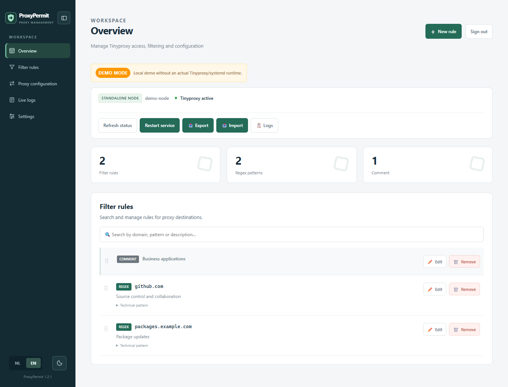

<!-- The branded header uses intentional HTML for GitHub alignment and sizing. -->
<!-- markdownlint-disable MD033 MD041 -->
<p align="center">
  
</p>

<h1 align="center">ProxyPermit</h1>

<p align="center">A clear, secure web console for Tinyproxy.</p>

<p align="center">
  <a href="https://dantdmnl.github.io/ProxyPermit/en/">English docs</a> ·
  <a href="https://dantdmnl.github.io/ProxyPermit/nl/">
    Nederlandse documentatie</a> ·
  <a href="https://github.com/Dantdmnl/ProxyPermit/releases">Releases</a> ·
  <a href="https://github.com/Dantdmnl/ProxyPermit/issues">Report an issue</a>
</p>
<!-- markdownlint-enable MD033 MD041 -->

ProxyPermit gives system administrators a web interface for managing Tinyproxy
on Linux. Control which clients may use the proxy, choose which destinations
they may reach, and review configuration changes before activating them.
Tinyproxy handles the proxy connections; ProxyPermit provides the management
console, accounts, audit trail and deployment tools.

Use it for a standalone proxy or a two-node setup with automatic policy
synchronization and a shared virtual IP. The interface and documentation are
available in **English and Dutch**, with light and dark themes.



*Example installation with synthetic data. [See the console in
use](https://dantdmnl.github.io/ProxyPermit/en/user-guide/).*

## What you can manage

- **Access and filtering:** manage client network access and destination
  allowlists or blocklists, using domains, wildcard patterns or regular
  expressions. Import, export, search and reorder filter rules.
- **Proxy configuration:** edit native Tinyproxy settings, validate drafts,
  review their impact and publish them with activation and recovery checks.
- **Users and accountability:** assign Monitor, Proxy manager or System
  administrator roles, enable optional authenticator-based 2FA, and identify
  the account responsible for changes through audit logs.
- **Logs and history:** filter live and retained logs by source, severity,
  text and date. Managed installations default to 30 days for audit/management
  logs and 7 days for Tinyproxy/traffic logs; storage limits can shorten history.
- **Installation and maintenance:** use a guided Linux installer and documented
  upgrade, migration, rollback and removal workflows.

HTTPS destinations use Tinyproxy's CONNECT support. Destination filtering can
match the tunnel's destination, not URL paths inside encrypted HTTPS traffic.
See the [user guide](docs/en/user-guide.md) for examples and filter-mode behavior.

## Choose your deployment

| Setup | How it works |
| --- | --- |
| Standalone | One Linux host runs the proxy and management console. No HA peer or Keepalived is required. |
| Two-node HA | Keepalived manages a shared virtual IP. Pair the nodes through the console, publish policy on A, and B automatically receives active filter rules and shared Tinyproxy settings over pinned TLS. |

In paired HA, **A remains the policy publisher** and B stays read-only for
shared policy, even when B serves proxy traffic. Accounts, passwords, 2FA,
sessions and host-specific settings remain local to each node. Signing in
through the virtual IP after takeover can require the other node's credentials.

**HA protection has limits.** The normal setup configures Keepalived and policy
synchronization, not quorum, a witness or fencing. A network partition can still
leave both nodes owning the virtual IP. The experimental Pacemaker/Corosync
integration is a separate, OS-prepared workflow; it is not enabled by an upgrade
or the normal HA wizard. Read [HA protection and its
limits](docs/en/high-availability.md#understand-failover-protection) before
choosing a production setup.

## Development preview

**[v1.4.0-dev.2](https://github.com/Dantdmnl/ProxyPermit/releases/tag/v1.4.0-dev.2)**
is a prerelease for disposable or recoverable test deployments. It adds local
protected-HA preparation in Settings, migration checks, rolling application
rollback and faster log browsing. Witness enrollment, fencing and activation
require OS administration. Read the
[release notes](CHANGELOG.md#140-dev2---2026-11-22) before testing.
**v1.3.0 remains the stable release.**

## Get started

For a new installation, use **Debian or Ubuntu with systemd, Python 3.10 or
later, and root/sudo access**. Download and extract a tagged archive from
[Releases](https://github.com/Dantdmnl/ProxyPermit/releases), then run the guided
installer from the directory containing `install.sh`:

```bash
sudo bash install.sh
```

The wizard guides you through the installation and asks you to review the plan.
To inspect a plan separately without applying changes:

```bash
sudo bash install.sh --plan
```

A fresh standalone installation binds the console and proxy to loopback.
Open a management tunnel, replacing `user@proxy-host` with your SSH login:

```bash
ssh -N -L 8080:127.0.0.1:8080 user@proxy-host
```

Visit **<http://127.0.0.1:8080>** and sign in with the administrator account
configured during installation. Before connecting LAN clients, configure
Tinyproxy's listener and client access rules for your network. The console
address and the client proxy address serve different purposes; a console
account alone does not configure a device to use the proxy.

Use the [installation guide](docs/en/installation.md) for network access, HTTPS,
unattended installation, upgrades and removal. For two nodes, start with the
[HA prerequisites](docs/en/installation.md#new-two-node-ha-cluster).

## Documentation

The documentation website is the main guide for users and administrators.
It follows `main` and may describe unreleased work; use the documentation
bundled with a release when you need instructions for that exact version.

| Documentation | English | Nederlands |
| --- | --- | --- |
| Start here / Begin hier | [Documentation](https://dantdmnl.github.io/ProxyPermit/en/) | [Documentatie](https://dantdmnl.github.io/ProxyPermit/nl/) |
| First steps / Eerste stappen | [Get started](docs/en/getting-started.md) | [Aan de slag](docs/nl/eerste-stappen.md) |
| Use the console / De interface gebruiken | [User guide](docs/en/user-guide.md) | [Werkinstructie](docs/nl/werkinstructie.md) |
| Users and roles / Gebruikers en rollen | [Permissions](docs/en/roles.md) | [Rechten](docs/nl/rollen.md) |
| Install, upgrade, or remove / Installeren, bijwerken of verwijderen | [Installation guide](docs/en/installation.md) | [Installatiehandleiding](docs/nl/installatie.md) |
| Daily operations / Dagelijks beheer | [Administrator guide](docs/en/administration.md) | [Beheerdershandleiding](docs/nl/beheer.md) |
| High availability / Hoge beschikbaarheid | [HA guide](docs/en/high-availability.md) | [HA-handleiding](docs/nl/hoge-beschikbaarheid.md) |
| Logging, privacy and retention / Logging, privacy en bewaartermijnen | [Logging guide](docs/en/logging.md) | [Logginghandleiding](docs/nl/logging.md) |

## Project status and roadmap

Use a tagged release for a versioned installation. The `main` branch contains
ongoing development; [Unreleased in the changelog](CHANGELOG.md#unreleased)
identifies changes that are not yet in a published release.

Current development includes direct management HTTPS with certificate setup and
renewal in the console, and preparation for guided quorum/fencing protection.
These are separate from Tinyproxy's support for HTTPS destinations. Protected
cluster provisioning, witness setup and migration are not yet a complete guided
workflow. Experimental features should be evaluated in a disposable lab first.

Follow the [English roadmap](docs/en/planned-work.md) or
[Nederlandse roadmap](docs/nl/vervolgwerk.md) for verified steps, experimental
work and remaining priorities. Checked steps do not mean that an entire
milestone is production-ready. Future work has no promised delivery dates.

## Development

Use the [VM test lab](docs/en/vm-lab.md) to exercise the installer, proxy
traffic, upgrade, recovery, or two-node HA on disposable guests.

In a Python 3.11+ virtual environment, install the development dependencies and
run the same checks used by CI:

```bash
python -m pip install -r requirements/dev.txt
python scripts/check.py
```

Use Linux or WSL for Gunicorn, shell and service checks. Windows development
uses Granian and skips platform-specific tests. For browser changes, run the
Playwright checks described in [AGENTS.md](AGENTS.md). The [verification
report](docs/en/verification.md) records the environments and failure scenarios
checked so far, along with remaining limits.

Preview the Zensical documentation site locally or publish it with GitHub Pages;
see [English](docs/en/documentation-site.md) /
[Nederlands](docs/nl/documentatiewebsite.md).

## Contribute and support the project

Finding ProxyPermit useful? [Give the project a
star](https://github.com/Dantdmnl/ProxyPermit) to help other administrators
discover it. Bug reports and improvements to the
[English and Dutch documentation](https://dantdmnl.github.io/ProxyPermit/) are
welcome too.

For a bug report, include the ProxyPermit version, deployment type, steps to
reproduce and the expected result. Remove passwords, pairing codes, tokens and
personal data from logs or screenshots before sharing them.

## License

ProxyPermit's own code is licensed under the [MIT License](LICENSE).
The separately bundled ClusterLabs fencing agent is **GPL-2.0-or-later**;
its [source, attribution and license](deploy/fence-agents/README.md) are included.
