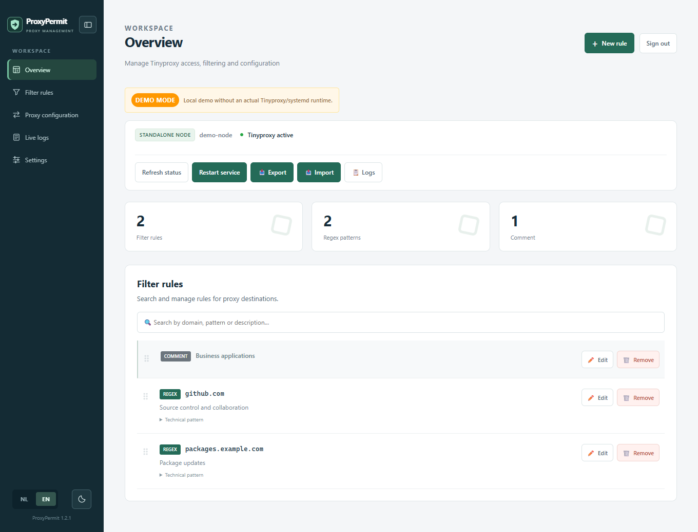

# ProxyPermit

<!-- The centered, explicitly sized logo needs HTML on GitHub. -->
<!-- markdownlint-disable MD033 -->
<p align="center">
  
</p>
<!-- markdownlint-enable MD033 -->

A clear, secure web console for Tinyproxy.

[English docs](https://dantdmnl.github.io/ProxyPermit/en/) ·
[Nederlandse documentatie](https://dantdmnl.github.io/ProxyPermit/nl/) ·
[Releases](https://github.com/Dantdmnl/ProxyPermit/releases) ·
[Report an issue](https://github.com/Dantdmnl/ProxyPermit/issues)

ProxyPermit is a web console for managing Tinyproxy on Linux. Use it to control
client access and destination filtering, stage and publish proxy configuration,
and investigate traffic through live logs. Each administrator can use a personal
account with optional two-factor authentication.

Run it on a single node or use two nodes with a shared virtual IP managed by
Keepalived. Pair existing standalone nodes through the web console; publishing
on the primary automatically replicates filter rules and shared Tinyproxy
settings
over pinned TLS. Each node keeps its own management accounts and host settings.
See the installation guide for migration from an existing HA deployment.



*Example installation with synthetic data. [Explore the
console](https://dantdmnl.github.io/ProxyPermit/en/user-guide/).*

| Documentation | English | Nederlands |
| --- | --- | --- |
| First steps / Eerste stappen | [Get started](docs/en/getting-started.md) | [Aan de slag](docs/nl/eerste-stappen.md) |
| Use the console / De interface gebruiken | [User guide](docs/en/user-guide.md) | [Werkinstructie](docs/nl/werkinstructie.md) |
| Users and roles / Gebruikers en rollen | [Permissions](docs/en/roles.md) | [Rechten](docs/nl/rollen.md) |
| Start here / Begin hier | [Documentation](docs/en/README.md) | [Documentatie](docs/nl/README.md) |
| Install, upgrade, or remove / Installeren, bijwerken of verwijderen | [Installation guide](docs/en/installation.md) | [Installatiehandleiding](docs/nl/installatie.md) |
| Daily operations / Dagelijks beheer | [Administrator guide](docs/en/administration.md) | [Beheerdershandleiding](docs/nl/beheer.md) |
| Logging, privacy and retention / Logging, privacy en bewaartermijnen | [Logging guide](docs/en/logging.md) | [Logginghandleiding](docs/nl/logging.md) |

## Quick start

For a new standalone installation, run these commands from the repository root
on Debian or Ubuntu with systemd and Python 3.10 or later. Review the plan
before
applying it.

```bash
bash install.sh --plan
sudo bash install.sh --apply
```

For an interactive setup, use `sudo bash install.sh`. On a fresh installation,
open the console through an [SSH
tunnel](docs/en/installation.md#open-the-console).
For two nodes, follow the [HA
prerequisites](docs/en/installation.md#new-two-node-ha-cluster).

## Development

Use the [VM test lab](docs/en/vm-lab.md) to exercise the installer, proxy
traffic, upgrade, recovery, or two-node HA on disposable guests.

Run `python -m pip install -r requirements/dev.txt` in a Python 3.11+ virtual
environment, then run `python scripts/check.py`. The [verification
report](docs/en/verification.md)
lists the Linux and HA scenarios tested so far.

The Zensical documentation site can be previewed locally and published with
GitHub Pages;
see [English](docs/en/documentation-site.md) /
[Nederlands](docs/nl/documentatiewebsite.md).

## Support the project

Finding ProxyPermit useful? [Give the project a
star](https://github.com/Dantdmnl/ProxyPermit)
to help other administrators discover it. Bug reports and improvements to the
[English and Dutch documentation](https://dantdmnl.github.io/ProxyPermit/) are
welcome too.
