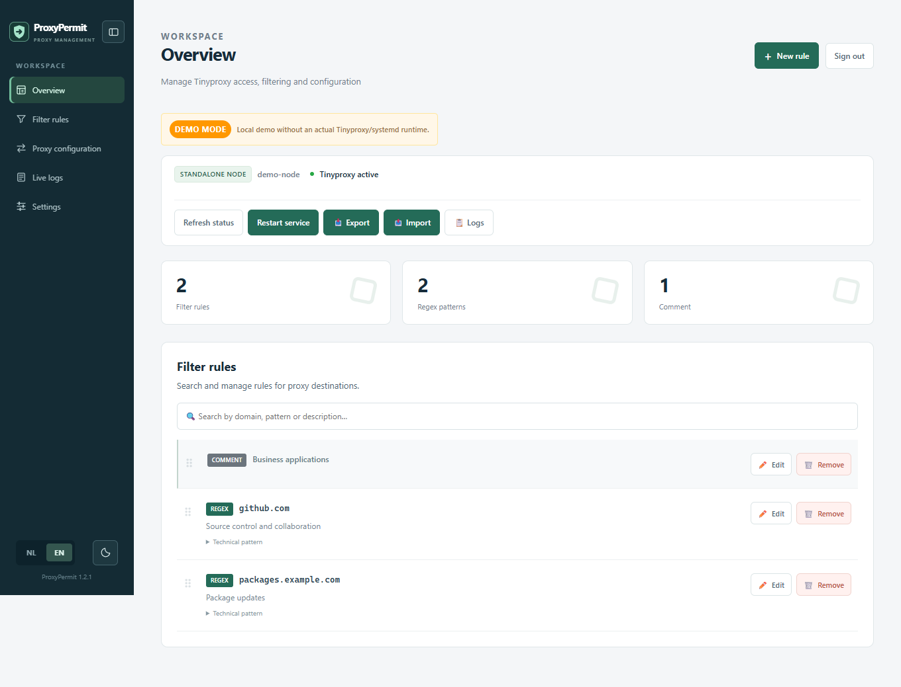
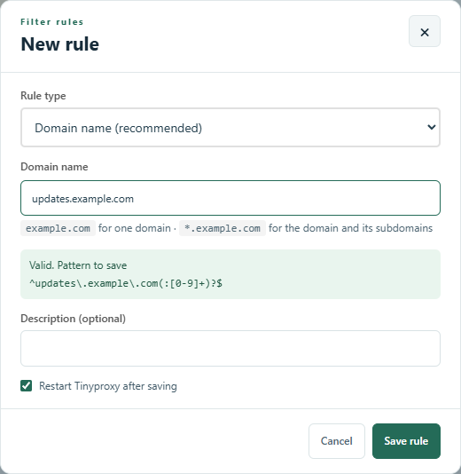
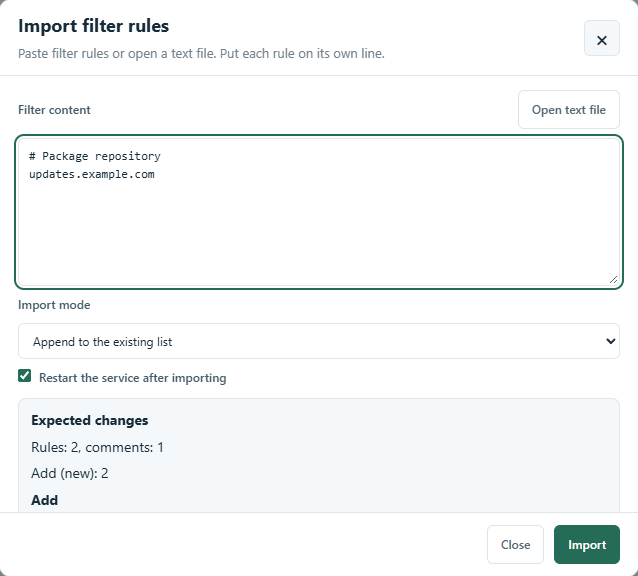
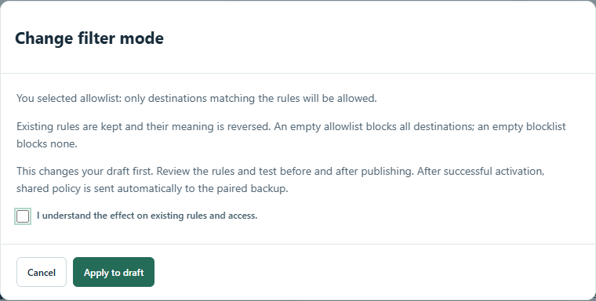
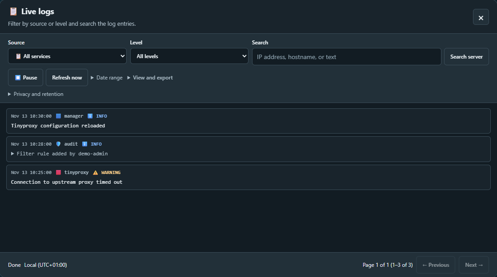
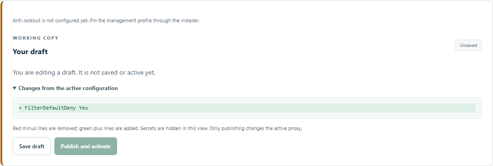
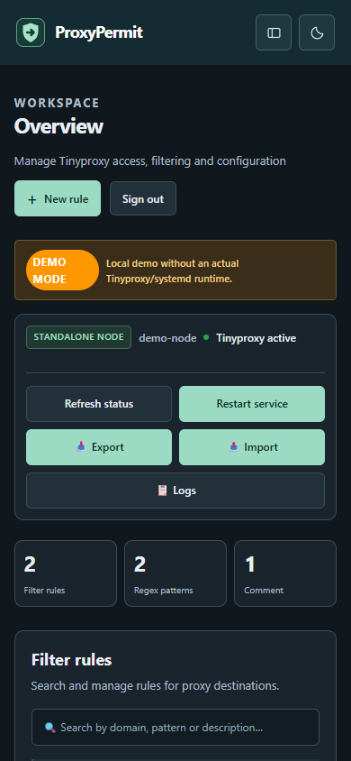

# Using the management console

[Nederlands](../nl/werkinstructie.md) · [Documentation](README.md)

This guide follows the controls in the web interface. Screenshots use an isolated
example installation; addresses, accounts and rules are not production data.
For installation and recovery commands, use the [administrator guide](administration.md).

New to the console? Start with [First steps](getting-started.md). Unfamiliar
words are explained in [Terms explained](glossary.md).

Select a screenshot to enlarge it. Use the arrows to browse and **×** or **Escape** to close it.

## Before you start

Get the management URL and your individual account from your administrator. The
management console is separate from the proxy listener, usually on port 3128.
Keep the management console on the trusted management network and use your
organization's HTTPS address. Do not ignore certificate warnings.

Your account has a [role](roles.md): monitor, proxy manager or system administrator.
Some actions in this guide require proxy or system management rights. Accounts,
passwords, 2FA and roles remain local to each node.

## Sign in and find your way

1. Open the management URL. Choose **EN** or **NL**; the theme button switches
   between light and dark mode.
2. Enter your username and password. The eye button reveals the password locally.
3. If your account uses 2FA, enter the current six-digit authenticator code.
   Pasting a complete code also works.
4. Open **Overview** for service status and destination rules, **Proxy
   configuration** for drafts and activation, or **Settings** for HA and accounts.
   **Live logs** opens over the current page without changing your location.

<figure class="docs-figure docs-figure--wide" markdown="span">
{ loading=lazy width="1360" height="1039" }
<figcaption>The overview brings node status, service actions and destination rules together.</figcaption>
</figure>

## Understand the two HA roles

| What you need to know | Node A | Paired node B |
| --- | --- | --- |
| Edit, delete or reorder shared rules | Yes | Read only |
| Publish shared Tinyproxy settings | Yes | Applied automatically from A |
| Serve clients through the VIP | When it owns the VIP | After failover, when it owns the VIP |
| Manage accounts and 2FA | Local accounts | Separate local accounts |

The active VIP node can change. This does not transfer policy editing authority
from A to B. The backup's persistent notice explains this restriction; attempts
to change rules are blocked in both the interface and server.

If A is unavailable, B continues using its last successfully applied policy.
Repair A before changing shared policy. Do not revoke pairing just to bypass
the read-only restriction.

## Add a destination rule

1. On the standalone node or node A, choose **New rule**.
2. Keep **Domain name** for ordinary destinations. `example.com` matches that
   domain; `*.example.com` includes the domain and its subdomains.
3. Optionally add a description so another administrator understands the reason.
   Use **Comment** for a section heading. Use regex only if you understand the
   configured POSIX pattern type.
4. Wait for the validation result next to the input. Correct errors before saving.
5. Leave **Restart Tinyproxy after saving** selected to apply the change. Choose
   **Save rule** and wait for the save and service result.
6. On HA, check **Settings → High availability → Policy synchronization** on
   both nodes. The published and applied revisions should converge. The backup
   receives changes asynchronously; its open rule list refreshes automatically.

<figure class="docs-figure docs-figure--dialog" markdown="span">
{ loading=lazy width="520" height="534" }
<figcaption>Add a domain and an optional description. Validation appears beside the input.</figcaption>
</figure>

If automatic restart is unchecked, saving the file does not by itself activate
the new filtering behavior or publish a changed active policy. Restart through
the console after reviewing the changes. Never assume a save alone reached B.

## Edit, delete and arrange rules

Use the search box to find a domain, pattern or description. **Edit** updates
the selected rule. **Remove** asks for confirmation; confirm the actual rule
you intend to remove. Changes can immediately affect client access.

Drag the handle to change the order on the standalone node or A. Ordering is
published to B automatically. If someone changed the list in the meantime,
refresh it before trying again; a stale reorder must not overwrite newer work.
Comments and order help readability; destination matching is governed by the
filter mode and pattern type, not by visual grouping alone.

If another administrator changes the list while you edit a rule or confirm a
deletion, the action is refused. Your editor input stays available. Copy any
text you want to keep, close the editor, refresh the list and reopen the intended
rule. Check its current contents before trying again.

## Import or export rules

1. Export the current list before a large change and store the download securely.
2. Choose **Import** and paste rules or open a text file. Put one rule on each
   line; comments begin with `#`.
3. Review validation and choose whether to append or replace. Replacement removes
   the existing list: do not select it unless the file is the complete desired list.
4. Review the restart choice and confirm import. Check the result, service state
   and, on HA, the applied revision on B.

<figure class="docs-figure docs-figure--dialog" markdown="span">
{ loading=lazy width="638" height="576" }
<figcaption>Choose a text file or paste one rule per line, then review the import mode.</figcaption>
</figure>

An exported list contains destination information. Follow your organization's
storage and deletion policy; downloaded files have no automatic retention timer.

## Switch between allowlist and blocklist

**Allowlist** permits matching destinations and blocks the rest. **Blocklist**
blocks matching destinations and permits the rest. Client access, proxy
authentication and CONNECT port restrictions still apply in both modes.

1. Open **Proxy configuration → Allowlist or blocklist**.
2. Select the desired mode and choose **Review change**.
3. Read the impact statement. Existing rules are preserved and reverse meaning.
   An empty allowlist blocks all destinations; an empty blocklist blocks none.
4. Acknowledge the effect and choose **Apply to draft**. Nothing is active yet.
5. Review every existing rule. Save any changed filter draft before publishing.
   Check the draft and save it if another administrator must review it first.
6. Choose **Publish and activate** and confirm the service restart. Failed
   activation restores the previous configuration; investigate the reported error.
7. Test both an expected allowed destination and an expected blocked destination
   from an actual proxy client. On HA, also verify the applied revision on B.

<figure class="docs-figure docs-figure--dialog" markdown="span">
{ loading=lazy width="760" height="384" }
<figcaption>Review the effect before applying a different filter mode to your draft.</figcaption>
</figure>

If filtering is disabled, first configure the intended filter file. This shortcut
does not silently create a new file, erase rules, change their pattern type, or
disable the client network restrictions. For HTTPS, Tinyproxy can filter the
CONNECT destination; it cannot see URL paths inside an encrypted tunnel.

## Read status without mistaking stale information for health

The VIP indicator reports ownership on the node whose console you opened, not a
cluster-wide promise. **Status unconfirmed** means the latest state could not be
verified. Do not interpret an old green indicator as proof that a node is alive.

Keepalived monitors bounded local Tinyproxy HTTP responses as well as exchanging
VRRP messages. This can detect a stopped or non-responsive proxy even when its
TCP port still exists. It does not test external DNS, upstream servers, every
client ACL, or complete real-world forwarding. Test those separately.

For a planned failover test, use the [VM lab](vm-lab.md) and record the VIP owner,
client result and policy revisions before and after. Two-node VRRP does not
eliminate split-brain risk during a network partition; redundant networking and
an appropriate fencing design are separate operational decisions.

## Inspect logs and troubleshoot

Open **Live logs** from any page. Select source and severity, search for text, or
use **Period** for local start/end dates. The dates refer to your browser's local
timezone. Pause the view while reading and use the live button to return to now.

<figure class="docs-figure docs-figure--wide" markdown="span">
{ loading=lazy width="1118" height="624" }
<figcaption>Filter by source or severity and inspect individual events. The log entries shown here are examples.</figcaption>
</figure>

Recognized local health-check traffic is hidden by default. **Show health checks**
or an explicit server search includes it. Warnings, errors, remote requests and
unidentified historical closed-socket errors remain visible. Downloads contain
the selected page, not every retained record.

The default managed retention is 30 days for audit/management and 7 days for
Tinyproxy traffic. Storage limits can shorten history. Review incomplete-result
notices and the [logging guide](logging.md) before drawing conclusions from an
empty result. A missing log entry does not prove an action never happened.

## Accounts, passwords and optional 2FA

In **Settings**, use **Change password** for your account. Follow the labels for
the new password and current-password confirmation; sensitive changes can also
require your current authenticator code. A password change revokes old sessions.

To enable 2FA, choose **Set up 2FA**, confirm your identity, scan the QR code with
your authenticator, then confirm using a fresh code. It is optional. Do not
photograph or share the QR code or setup key. Follow the administrator's recovery
procedure if access to the authenticator is lost.

Use individual accounts rather than sharing an administrator login. Add and
remove administrators only after checking their intended access. Removing a
console account does not remove any proxy authentication configured in Tinyproxy.

## Connection lost during a change

Keep the tab open: your input and dialogs remain on the page. The console checks
again automatically. It does not replay write requests or reload the page after
recovery. If a response was lost, verify the actual result before repeating the
action. Reloading or opening a page still requires a reachable server.

For planned improvements, see [Follow-up work](planned-work.md).

## See exactly what is in your draft

The **Your draft** panel shows whether work is unsaved, saved but inactive, or
already identical to the active configuration. Red minus lines will be removed;
green plus lines will be added. This also shows changes to rule order in the
native configuration. Password-bearing directives are masked in this comparison.
For very large files, review the complete native editor instead.

<figure class="docs-figure docs-figure--wide" markdown="span">
{ loading=lazy width="1078" height="365" }
<figcaption>The draft comparison shows exactly which settings would be added or removed.</figcaption>
</figure>

Use the panel's save, publish or discard action for the indicated draft. A saved
configuration draft survives reloading; unsaved editor text does not. A pending
filter draft is identified separately and can be discarded separately. The
backup stays read only even when it currently owns the VIP.

## Anti-lockout protection

**Settings → Anti-lockout** shows the trusted management networks and protected
SSH, web and proxy ports. An OS administrator pins this profile during installation
or upgrade. The GUI cannot delete the protected client Allow block or narrow the
protected proxy port/listener. These are local exceptions and do not get replaced
by policy synchronization. HA retirement keeps the dedicated UFW safety rules.

Destination filtering is still enforced. This does not grant unrestricted web
access: configure direct management access or a browser proxy-bypass entry for
the console. The profile cannot fix routing, upstream firewalls or incorrect
certificates. If the panel says **Not configured**, ask the OS administrator to
commission it using the [administrator instructions](administration.md#anti-lockout-profile).

## On a phone or smaller screen

Use the navigation button beside the logo to open the menu. The same pages and
permissions apply on smaller screens. On this documentation site, select a
screenshot to enlarge it; zoom in for detail and press **Escape** to close it.

??? example "Show the mobile console in dark mode"

    <figure class="docs-figure docs-figure--mobile" markdown="span">
    { loading=lazy width="390" height="844" }
    <figcaption>The mobile overview keeps status and service actions within reach.</figcaption>
    </figure>
