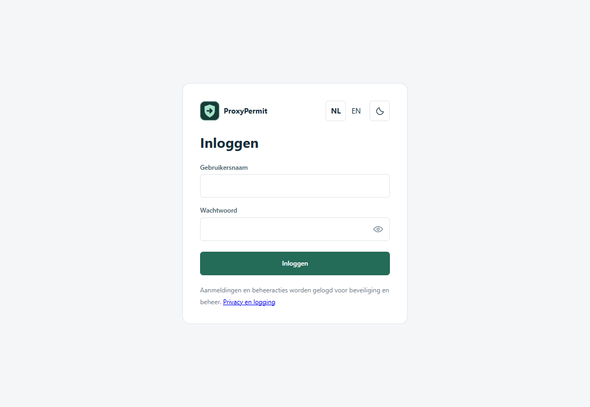
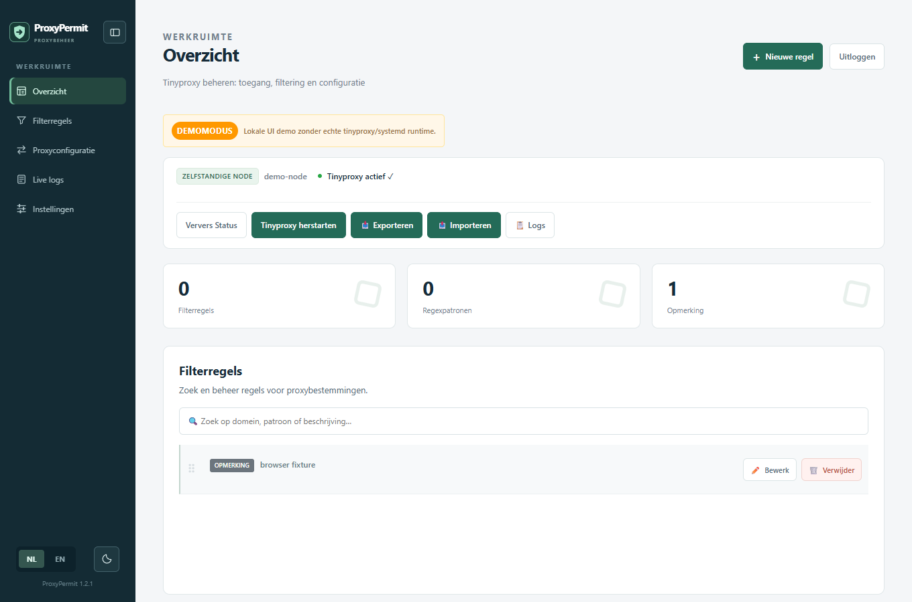
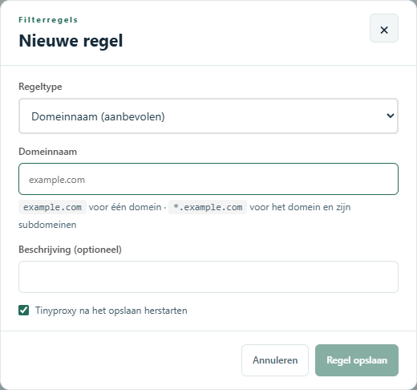
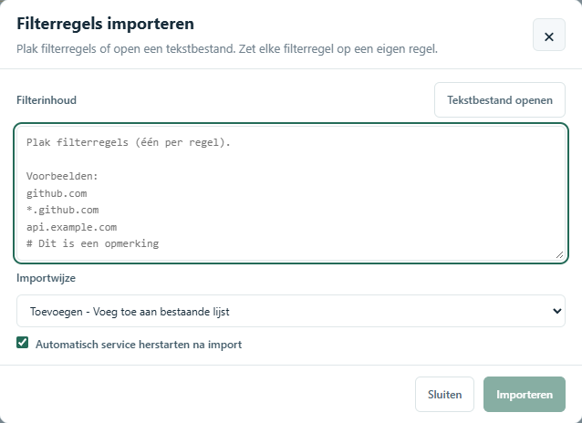
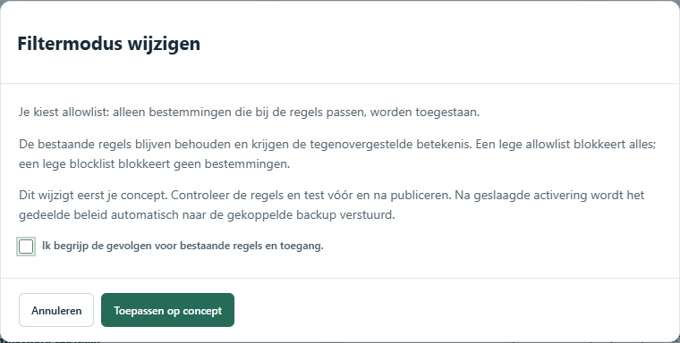
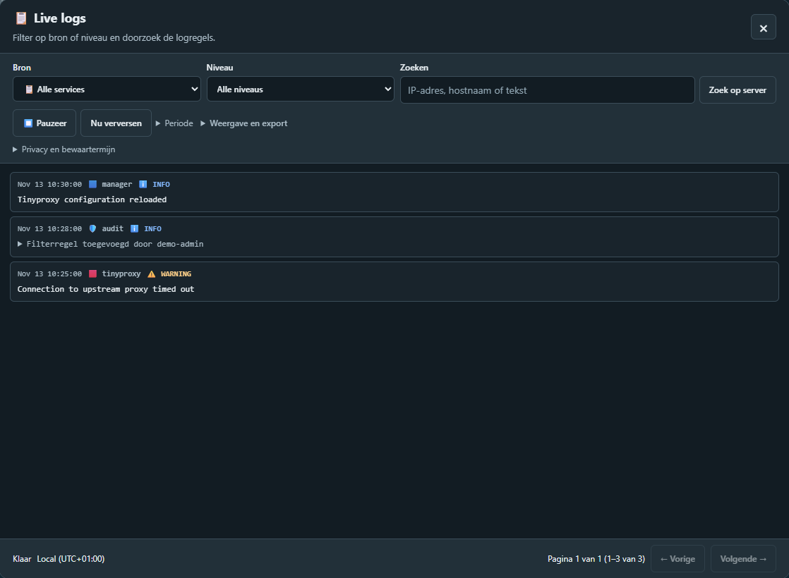
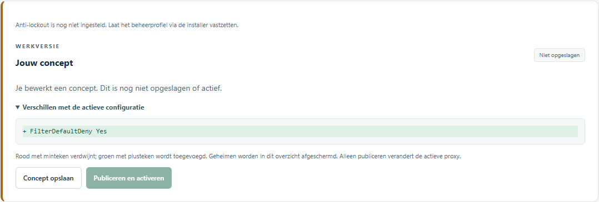
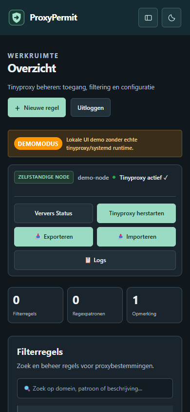

# Werken met de beheerconsole

[English](../en/user-guide.md) · [Documentatie](README.md)

Deze instructie volgt de knoppen in de webinterface. De schermafbeeldingen komen uit
een afzonderlijke voorbeeldinstallatie; adressen, accounts en regels zijn geen
productiegegevens. Installatie- en herstelcommando's staan in de
[beheerdershandleiding](beheer.md).

Nieuw in de interface? Begin bij [Eerste stappen](eerste-stappen.md). Onbekende
termen vind je bij [Begrippen uitgelegd](begrippen.md).

## Voor je begint

Vraag de beheerder om het beheeradres en een persoonlijk account. De beheerconsole
is iets anders dan de proxyverbinding, die meestal poort 3128 gebruikt. Gebruik
het vertrouwde beheernetwerk en het HTTPS-adres van je organisatie. Negeer geen
certificaatwaarschuwingen.

Je account heeft een [rol](rollen.md): monitor, proxybeheerder of systeembeheerder.
Voor sommige stappen heb je proxy- of systeembeheerdersrechten nodig. Accounts,
wachtwoorden, 2FA en rollen blijven lokaal op iedere node.

## Inloggen en de weg vinden

1. Open het beheeradres en kies **NL** of **EN**. Met de themaknop wissel je
   tussen de lichte en donkere weergave.
2. Vul gebruikersnaam en wachtwoord in. Met het oogje kun je het ingevulde wachtwoord bekijken.
3. Gebruikt je account 2FA? Vul de actuele zescijferige code uit je authenticator
   in. Je kunt ook een volledige code plakken.
4. Open **Overzicht** voor diensten en bestemmingsregels, **Proxyconfiguratie**
   voor concepten en activering, of **Instellingen** voor HA en accounts.
   **Live logs** opent boven de huidige pagina; je verlaat die pagina niet.

## Begrijp de twee HA-rollen

| Wat wil je doen? | Node A | Gekoppelde node B |
| --- | --- | --- |
| Gedeelde regels wijzigen, verwijderen of verplaatsen | Ja | Alleen lezen |
| Gedeelde Tinyproxy-instellingen publiceren | Ja | Worden automatisch van A overgenomen |
| Clients via het VIP bedienen | Wanneer deze node het VIP heeft | Na overname, wanneer deze node het VIP heeft |
| Accounts en 2FA beheren | Lokale accounts | Afzonderlijke lokale accounts |

Het VIP kan van eigenaar wisselen. Daarmee verhuist het recht om gedeeld beleid
te wijzigen niet van A naar B. De blijvende melding op B legt dit uit. Zowel de
interface als de server blokkeren pogingen om daar regels te wijzigen.

Is A onbereikbaar? B blijft het laatst succesvol toegepaste beleid gebruiken.
Herstel A voordat je gedeeld beleid wijzigt. Trek de koppeling niet in om de
leesbeperking te omzeilen.

## Een bestemmingsregel toevoegen

1. Kies op de zelfstandige node of op A **Nieuwe regel**.
2. Gebruik **Domeinnaam** voor normale bestemmingen. `example.com` geldt voor
   dat domein; `*.example.com` neemt ook de subdomeinen mee.
3. Voeg eventueel een omschrijving toe die de reden uitlegt. Gebruik
   **Opmerking** voor een tussenkop. Gebruik regex alleen als je het ingestelde
   POSIX-patroontype begrijpt.
4. Wacht op de validatie naast de invoer en los fouten op voordat je opslaat.
5. Laat **Tinyproxy herstarten na opslaan** aangevinkt om de wijziging toe te
   passen. Kies **Regel opslaan** en wacht op het resultaat van opslaan en herstarten.
6. Controleer bij HA op beide nodes **Instellingen → Hoge beschikbaarheid →
   Beleidssynchronisatie**. De gepubliceerde en toegepaste revisie moeten gelijk
   worden. De overdracht verloopt asynchroon; een geopende regellijst op B wordt
   automatisch ververst.

Zonder automatische herstart wordt het bestand wel opgeslagen, maar is het
nieuwe filtergedrag daarmee nog niet actief of als gewijzigd actief beleid
gepubliceerd. Herstart na controle via de console. Ga er niet van uit dat alleen
opslaan de wijziging al naar B heeft gebracht.

## Regels bewerken, verwijderen en ordenen

Zoek op domein, patroon of omschrijving. Met **Bewerk** wijzig je de gekozen regel.
**Verwijder** vraagt om bevestiging: controleer welke regel je verwijdert.
Wijzigingen kunnen de toegang van clients direct veranderen.

Versleep de handgreep op de zelfstandige node of A om regels te ordenen. De
volgorde wordt automatisch naar B gepubliceerd. Heeft iemand de lijst intussen
gewijzigd? Ververs de lijst voordat je opnieuw sleept; een oude volgorde mag nieuw
werk niet overschrijven. Opmerkingen en ordening maken de lijst leesbaarder.
Welke bestemmingen passen, wordt bepaald door filtermodus en patroontype, niet
alleen door de zichtbare groepering.

Wijzigt een andere beheerder de lijst terwijl je een regel bewerkt of een
verwijdering bevestigt? Dan wordt jouw actie geweigerd. Je invoer blijft in het
bewerkvenster staan. Kopieer tekst die je wilt bewaren, sluit het venster, ververs
de lijst en open de bedoelde regel opnieuw. Controleer de huidige inhoud voordat
je het opnieuw probeert.

## Regels importeren of exporteren

1. Exporteer de huidige lijst voor een grote wijziging en bewaar de download veilig.
2. Kies **Importeren** en plak regels of open een tekstbestand. Zet iedere regel
   op een eigen regel; opmerkingen beginnen met `#`.
3. Controleer de validatie en kies toevoegen of vervangen. Vervangen verwijdert
   de bestaande lijst: kies dit alleen als het bestand de volledige gewenste lijst is.
4. Controleer de herstartkeuze en bevestig. Controleer daarna resultaat,
   servicestatus en bij HA de toegepaste revisie op B.

Een export bevat bestemmingsinformatie. Volg het opslag- en verwijderbeleid van
je organisatie; downloads hebben geen automatische bewaartermijn.

## Wisselen tussen allowlist en blocklist

Een **allowlist** staat passende bestemmingen toe en blokkeert de rest. Een
**blocklist** blokkeert passende bestemmingen en staat de rest toe. Clienttoegang,
proxy-authenticatie en CONNECT-poortbeperkingen blijven in beide modi gelden.

1. Open **Proxyconfiguratie → Allowlist of blocklist**.
2. Kies de gewenste modus en klik op **Wijziging bekijken**.
3. Lees de gevolgen. Bestaande regels blijven behouden en krijgen een omgekeerde
   betekenis. Een lege allowlist blokkeert alles; een lege blocklist blokkeert geen
   bestemmingen.
4. Bevestig dat je dit begrijpt en kies **Toepassen op concept**. Er is nog niets actief.
5. Controleer alle bestaande regels. Sla een gewijzigd filterconcept op voordat
   je publiceert. Controleer het concept en sla het eventueel eerst op voor review.
6. Kies **Publiceren en activeren** en bevestig de herstart. Mislukt de activering,
   dan wordt de vorige configuratie teruggezet. Onderzoek de getoonde fout.
7. Test vanaf een echte proxyclient zowel een bestemming die toegestaan moet
   zijn als een bestemming die geblokkeerd moet zijn. Controleer bij HA ook de
   toegepaste revisie op B.

Is filtering uitgeschakeld, configureer dan eerst het bedoelde filterbestand.
Deze snelkoppeling maakt niet stilzwijgend een nieuw bestand, wist geen regels,
verandert geen patroontype en schakelt clientbeperkingen niet uit. Bij HTTPS kan
Tinyproxy de CONNECT-bestemming filteren; URL-paden binnen de versleutelde tunnel
zijn niet zichtbaar.

## Actuele status en overname controleren

De VIP-indicator toont eigenaarschap op de node waarvan je de console hebt
geopend, geen garantie voor het hele cluster. **Status niet bevestigd** betekent
dat de actuele toestand niet gecontroleerd kon worden. Een oude groene status
is geen bewijs dat een node nog werkt.

Keepalived controleert lokale HTTP-antwoorden van Tinyproxy met een tijdslimiet
en wisselt VRRP-berichten uit. Daarmee kan ook een proxy worden afgekeurd die nog
een luisterpoort heeft, maar niet meer antwoordt. Dit test geen externe DNS,
achterliggende proxyservers, elke toegangsregel of volledige proxyverzoeken. Test die apart.

Gebruik voor een geplande overnametest het [VM-testlab](vm-lab.md). Noteer
VIP-eigenaar, clientresultaat en beleidsrevisies voor en na de test. VRRP met twee
nodes sluit split-brain bij een netwerkonderbreking niet uit. Redundante netwerken
en een passend fencing-ontwerp zijn afzonderlijke beheerkeuzes.

## Logs bekijken en problemen onderzoeken

Open **Live logs** vanaf de huidige pagina. Kies bron en niveau, zoek tekst of
gebruik **Periode** met begin- en einddatum. De datums gebruiken de lokale
tijdzone van je browser. Pauzeer tijdens het lezen en keer daarna terug naar live.

Herkenbaar lokaal verkeer van gezondheidscontroles is standaard verborgen. Met
**Gezondheidscontroles tonen** of een expliciete serverzoekopdracht zie je het
wel. Waarschuwingen, fouten, externe verzoeken en niet-herkende historische
gesloten-socketmeldingen blijven zichtbaar. Een download bevat de geselecteerde
pagina, niet de volledige bewaarde geschiedenis.

Beheerde logs worden standaard 30 dagen bewaard voor audit en beheer, en 7 dagen
voor Tinyproxy-verkeer. Schijflimieten kunnen de geschiedenis verkorten. Let op
meldingen over onvolledige resultaten en lees de [logginghandleiding](logging.md).
Een ontbrekende logregel bewijst niet dat een actie nooit is uitgevoerd.

## Accounts, wachtwoorden en optionele 2FA

Gebruik onder **Instellingen** de knop **Wachtwoord wijzigen** voor je eigen
account. Volg de labels voor het nieuwe wachtwoord en de bevestiging met je
huidige wachtwoord; gevoelige acties kunnen ook je huidige authenticatorcode
vragen. Een wachtwoordwijziging trekt oude sessies in.

Kies **2FA instellen**, bevestig je identiteit, scan de QR-code met je
authenticator en bevestig met een verse code. 2FA is optioneel. Deel geen foto
van de QR-code of instelsleutel. Volg bij verlies van je authenticator de
herstelprocedure van de beheerder.

Gebruik persoonlijke accounts in plaats van een gedeelde beheerderslogin. Voeg
alleen beheerders toe na controle van de bedoelde toegang. Een consoleaccount
verwijderen verwijdert geen afzonderlijke Tinyproxy-proxy-authenticatie.

## Verbinding verloren tijdens een wijziging

Houd het tabblad open: invoer en dialoogvensters blijven op de pagina staan.
De console probeert automatisch opnieuw verbinding te maken. Schrijfverzoeken
worden niet herhaald en de pagina wordt bij herstel niet herladen. Ging een
antwoord verloren, controleer dan eerst het resultaat voordat je de actie
herhaalt. Herladen of een nieuwe pagina openen vereist een bereikbare server.

Geplande verbeteringen staan bij [Vervolgwerk](vervolgwerk.md).

## Precies zien wat in je concept staat

Het paneel **Jouw concept** laat zien of werk nog niet is opgeslagen, is opgeslagen
maar nog niet actief is, of gelijk is aan de actieve configuratie. Rode minregels
verdwijnen; groene plusregels worden toegevoegd. Ook een andere regelvolgorde in
het Tinyproxy-configuratiebestand wordt zichtbaar. Wachtwoordhoudende instellingen worden
in deze vergelijking afgeschermd. Controleer grote bestanden in de editor voor het configuratiebestand.

Gebruik de zichtbare actie om het betreffende concept op te slaan, te publiceren
of te verwerpen. Een opgeslagen configuratieconcept blijft na herladen bestaan;
niet-opgeslagen editortekst niet. Een filterconcept wordt afzonderlijk aangegeven
en kan afzonderlijk worden verworpen. De back-upnode blijft alleen-lezen, ook wanneer
die het VIP bedient.

## Anti-lockoutbescherming

Onder **Instellingen → Anti-lockout** zie je de vertrouwde beheernetwerken en de
beschermde SSH-, web- en proxypoorten. Een OS-beheerder zet het profiel via de
installer vast. De webinterface kan het vaste Allow-beheerblok niet verwijderen en kan de
beschermde proxypoort of luisterbinding niet beperken. Deze lokale uitzonderingen
worden niet door HA-beleid vervangen. Bij HA-verwijdering blijven de aparte
UFW-beheerregels behouden.

Bestemmingsfilters blijven gelden: dit geeft geen onbeperkte internettoegang.
Gebruik directe beheertoegang of een proxy-uitzondering voor het consoleadres in
je browser. Het profiel herstelt geen routering, externe firewalls of verkeerde
certificaten. Staat er **Nog niet ingesteld**, laat het profiel dan inrichten
volgens de [beheerdersinstructies](beheer.md#anti-lockoutprofiel).

## Op een telefoon of kleiner scherm

Open het menu met de navigatieknop naast het logo. Op een kleiner scherm gebruik
je dezelfde pagina’s en gelden dezelfde rechten. Op deze documentatiewebsite kun
je een schermafbeelding aanklikken om die te vergroten. Kies **Inzoomen** voor
meer detail en sluit de afbeelding met **Escape**.

??? example "Toon de mobiele beheerconsole in donkere modus"

    
